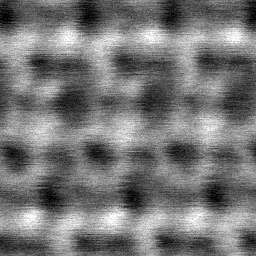
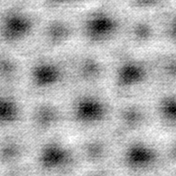

# STEM noise calibration

This directory provides the SFIN-era noise calibration procedure used as the basis for SFFN/AtoMix data simulation, together with 40 real STEM sample images and the archived direct calibration estimates.

## Direct calibration and simulation settings

**The parameter ranges used for data simulation were manually fine-tuned based on the directly calibrated parameters.** The archived direct estimates are intermediate measurements, while `../haadf.py` and `../bf.py` contain the manually adjusted parameter settings used by the released synthesis scripts. Running this calibration script does not automatically regenerate or overwrite those final settings.

For the scan and pointwise noise coefficients, each pair in `haadf_params` or `bf_params` specifies the mean and standard deviation used by `random.normalvariate`, rather than hard minimum/maximum bounds. The background minimum and scale in the released generators are separately set to `randint(0, 50)` and `randint(50, 100)`. See the actual generators for the complete synthesis process.

| Files | Contents |
| --- | --- |
| `calibrate.py` | Shared HAADF/BF calibration implementation |
| `samples/haadf/0.png` through `19.png` | 20 real HAADF calibration crops |
| `samples/bf/0.png` through `19.png` | 20 real BF calibration crops |
| `historical_results/haadf/` | Archived direct HAADF calibration estimates |
| `historical_results/bf/` | Archived direct BF calibration estimates |
| `manifest.json` | SHA-256 checksums of the unchanged samples and archived estimates |

The HAADF files come from the October 8, 2024 calibration archive; the BF files come from the October 12, 2024 archive. Their original calibration scripts differ only in the BF mode switch. The shared release script adds command-line arguments, a main guard, support for Windows Unicode paths, and checks for valid inputs and an empty output directory. It does not delete existing outputs.

## Run

Install the calibration dependencies (also listed in the repository requirements):

```bash
pip install numpy scipy opencv-python matplotlib
```

From the repository root:

```bash
python calibration/calibrate.py --mode haadf --output calibration/outputs/haadf
python calibration/calibrate.py --mode bf --output calibration/outputs/bf
```

For a quick run, add `--limit 1`. To calibrate your own images, provide an input directory:

```bash
python calibration/calibrate.py --mode haadf --input /path/to/png_images --output /path/to/new_results
```

Inputs are grayscale PNG images on the 0–255 intensity scale. Color PNGs are read as grayscale. Use a new or empty output directory for each run. The historical procedure bins intensities and gradient magnitudes into 256 bins; the script reports an error if a gradient exceeds this range or too few populated bins remain for fitting.

## Procedure and outputs

1. Apply a 15×15 Gaussian blur and a 21×1 row-wise Gaussian blur.
2. Estimate scan noise as the row-wise blurred image minus the two-dimensional blurred image. Fit its standard deviation against the Sobel gradient magnitude.
3. Estimate pointwise noise (called `Read Noise` in the historical code) as the original image minus the row-wise blurred image. Fit its standard deviation against image intensity and fit a Tukey lambda distribution at intensity bins 50, 100, and 150.
4. Estimate background and atomic brightness using the minimum/maximum of the blurred image, with contrast inversion for BF.
5. Aggregate the image-level estimates into parameter distributions and brightness ranges.

The script retains the historical fitting conventions: the linear fit uses the first 80% of populated bins, and each image's Tukey shape estimate is the sum of the available fitted lambda values divided by three. If any of the three intensity bins lacks enough pixels, this historical rule differs from averaging only the available fits. The fitted Tukey scale is not used as the pointwise standard-deviation estimate; that estimate comes from the separate Gaussian fit.

Each run writes diagnostic PNG/SVG plots and seven text files:

- `Scan Noise k.txt` and `Scan Noise b.txt`: slope/intercept of scan-noise standard deviation versus gradient magnitude.
- `Read Noise k.txt` and `Read Noise b.txt`: slope/intercept of pointwise-noise standard deviation versus intensity.
- `Read Noise λ.txt`: Tukey lambda shape estimates.
- `Background Brightness.txt` and `Atom Brightness.txt`: background and atomic-contrast ranges.

The first line of a noise parameter file is the fitted mean and standard deviation across images. The first line of a brightness file is its minimum and maximum. Remaining lines contain the image index and individual estimate. Numeric image stems are sorted numerically. SciPy optimizer/version differences may produce small differences from the archived estimates, especially for Tukey lambda fits.

The release script was validated on all 40 bundled images: the first-line summaries of all seven parameter files matched the archived results exactly for both modes in the validation environment.

## Sample images

| HAADF | BF |
| --- | --- |
|  |  |
